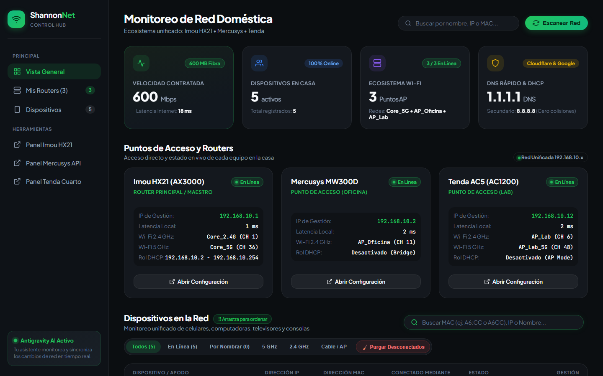

# Network & Router Telemetry Dashboard


Panel ligero de observabilidad y telemetría de red local construido en **Node.js puro (cero dependencias externas en `node_modules`)**. Integra sondeo concurrente de latencia **ICMP** con autenticación criptográfica *challenge-response* de **doble hash MD5 sobre JSON-RPC 2.0** para consultar clientes Wi-Fi (2.4 GHz / 5 GHz), enlaces Ethernet, tráfico WAN e identificación OUI de fabricantes por dirección MAC.



---

## Aspectos Técnicos Destacados

* **Autenticación Criptográfica Challenge-Response (JSON-RPC 2.0):** Negociación de sesión en dos pasos (`realm` + `random` challenge) firmada con doble digest MD5 mediante el módulo nativo `crypto` y renovación transparente de sesión ante códigos de expiración.
* **Sondeo Concurrente No Bloqueante:** Ejecución en paralelo (`Promise.all`) de pruebas ICMP hacia nodos de infraestructura y llamadas RPC sin bloquear el *event loop*.
* **Resolución OUI & Detección de MAC Aleatoria:** Clasificación automática de fabricantes por prefijo hexadecimal e identificación del bit *Locally Administered* (`0x02`) para distinguir direcciones MAC privadas móviles.
* **Modo Demo Integrado:** Permite levantar y evaluar toda la interfaz sin necesidad de hardware físico conectado (`npm run demo`).

---

## Ejecución Rápida

```bash
git clone https://github.com/Jesus-Soto-Noto/network-telemetry-dashboard.git
cd network-telemetry-dashboard

# Ejecutar en modo demostración interactiva:
npm run demo

# O conectar a infraestructura real configurando variables de entorno:
cp .env.example .env
node server.js
```

---

## Autor

**Jesús A. Soto Noto** — Desarrollador de Software Full Stack  
[LinkedIn](https://www.linkedin.com/in/jesus-soto-noto) · [GitHub](https://github.com/Jesus-Soto-Noto)
